# FinTrack — Cas d’utilisation (diagrammes Mermaid)

Version 1.1 — 18 octobre 2026. Ce fichier contient le code Mermaid des diagrammes de cas d’utilisation. Le document complet (catalogue, fiches, couverture) est `FinTrack_Cas_Utilisation_V1.1.docx`.

## Conventions

Mermaid n’a pas de diagramme de cas d’utilisation UML natif. Les diagrammes ci-dessous utilisent un `flowchart` :

- rectangle bleu : acteur ;
- ovale : cas d’utilisation, numéroté `UC-nnn` ;
- ovale en pointillés : cas d’un autre module, montré pour la relation ;
- flèche pleine : l’acteur déclenche le cas ;
- flèche en pointillés `«include»` : le cas source inclut toujours le cas cible ;
- flèche en pointillés `«extend»` : le cas source étend le cas cible dans certaines conditions (la flèche part de l’extension).

Acteurs : **Utilisateur** (seul acteur humain) et **Planificateur système** (déclenchements automatiques : clôture de budget, alertes, occurrences récurrentes, sauvegarde automatique).

## 0. Vue d’ensemble des modules

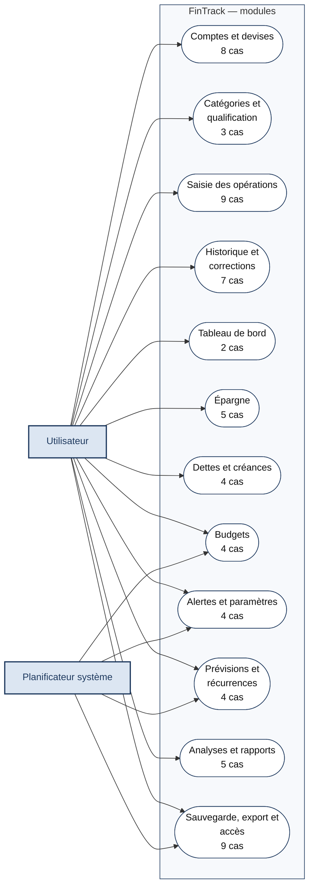

## 1. Comptes et devises

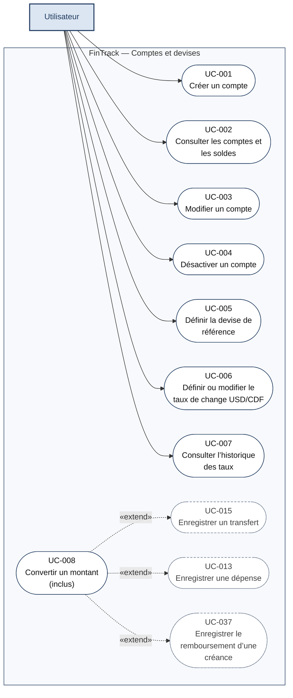

## 2. Catégories et qualification

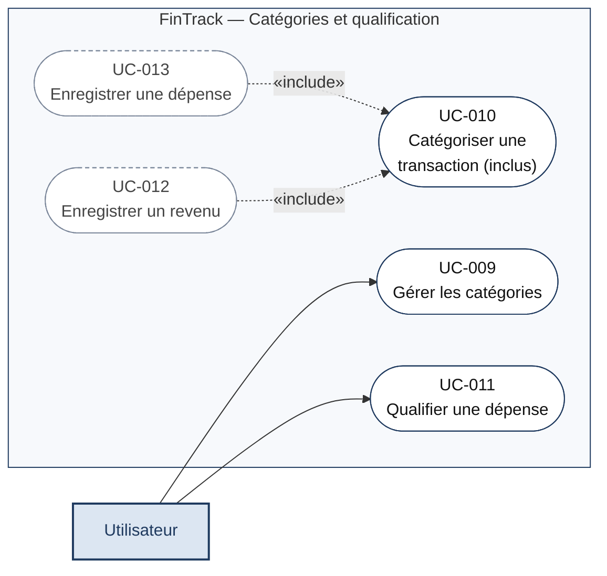

## 3. Saisie des opérations

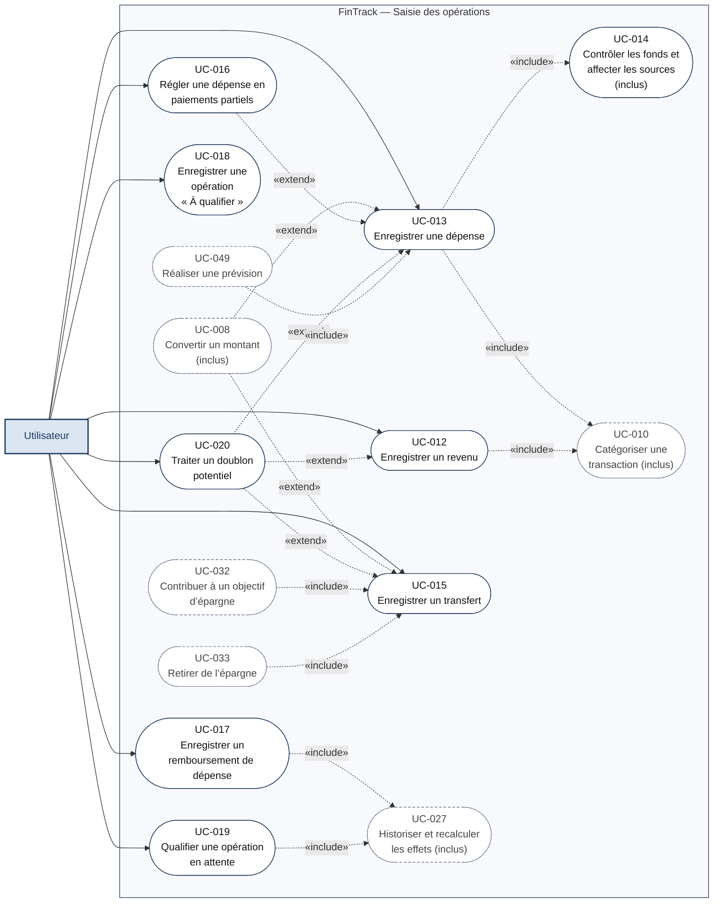

## 4. Historique et corrections

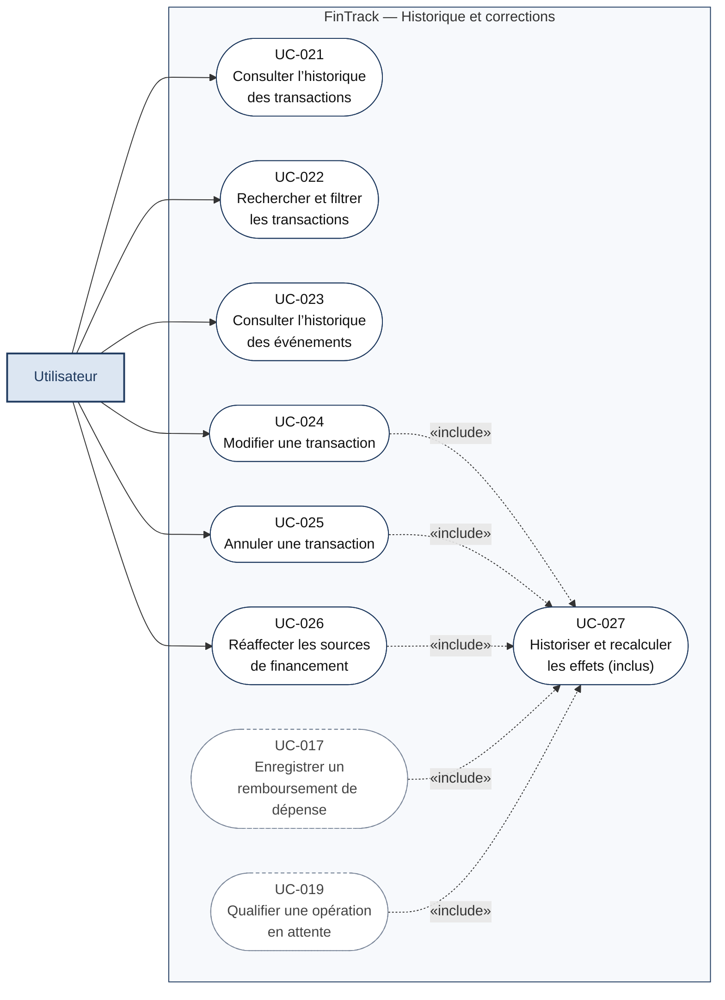

## 5. Tableau de bord

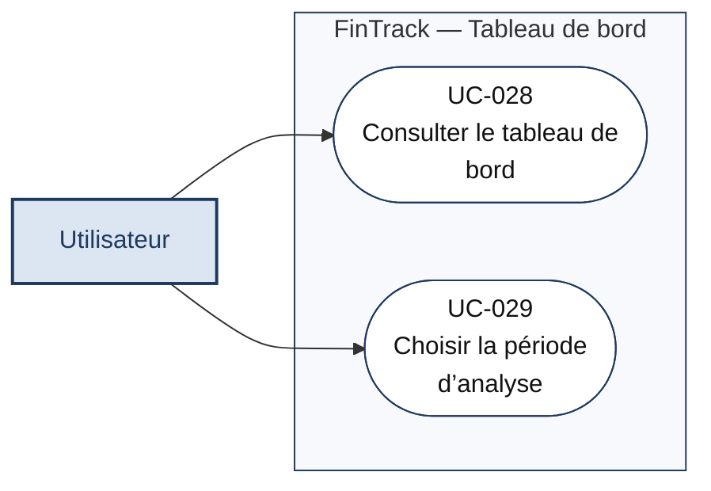

## 6. Épargne

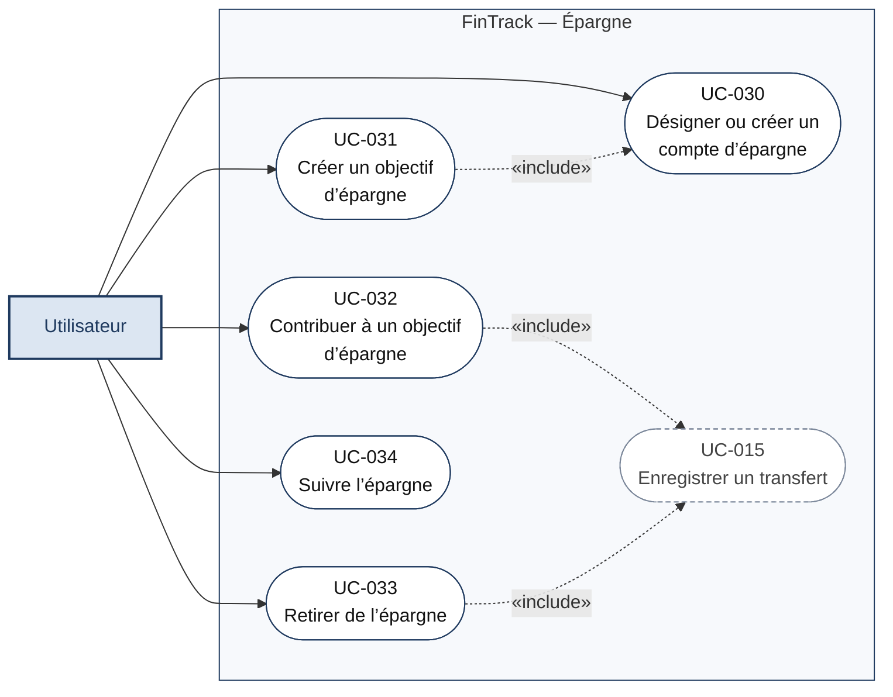

## 7. Dettes et créances

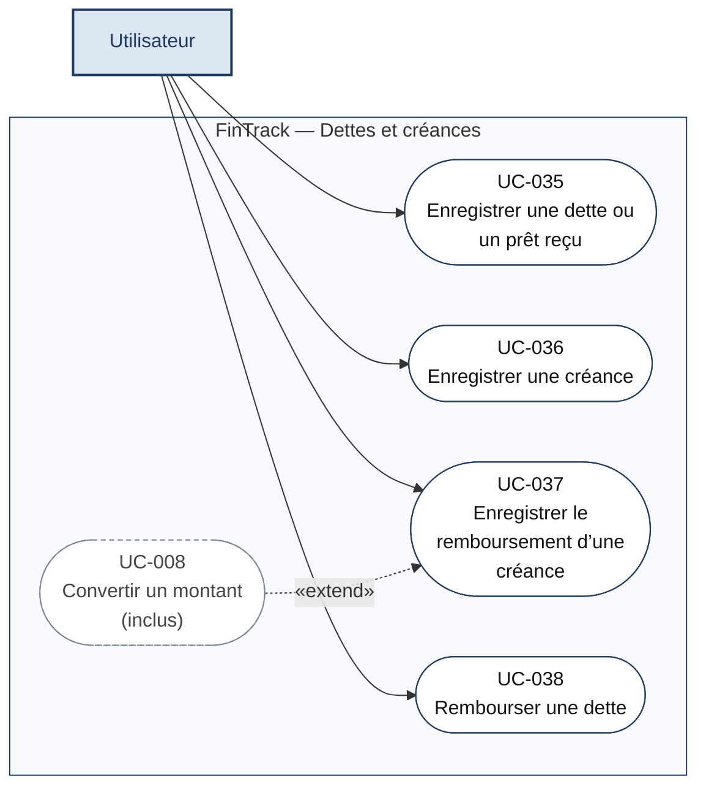

## 8. Budgets

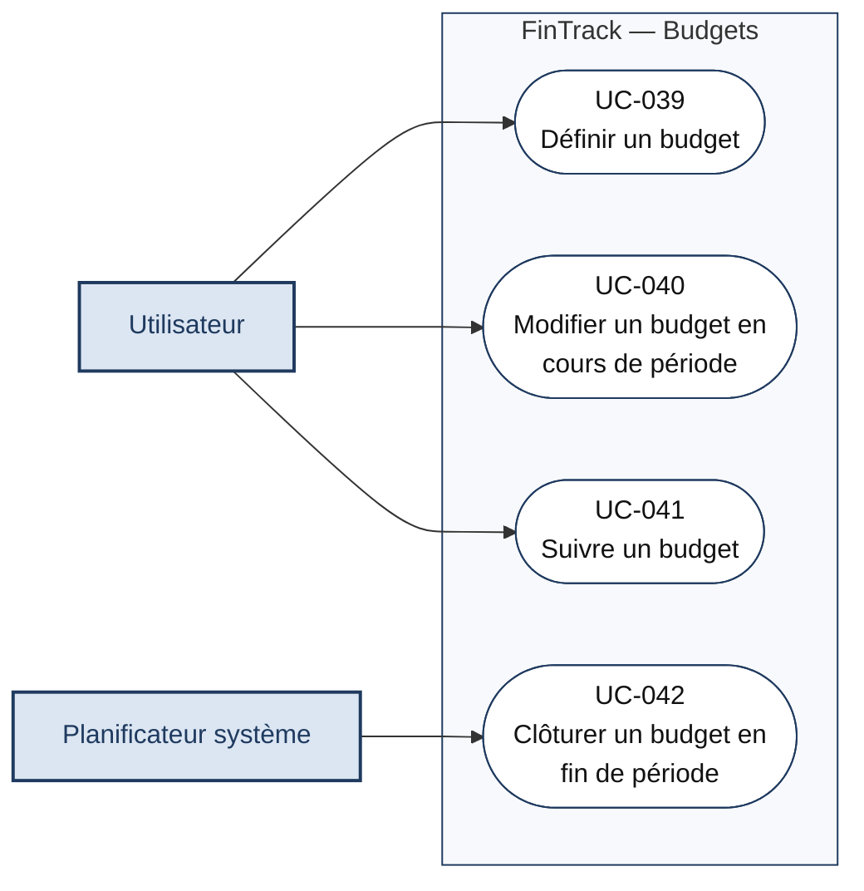

## 9. Alertes et paramètres

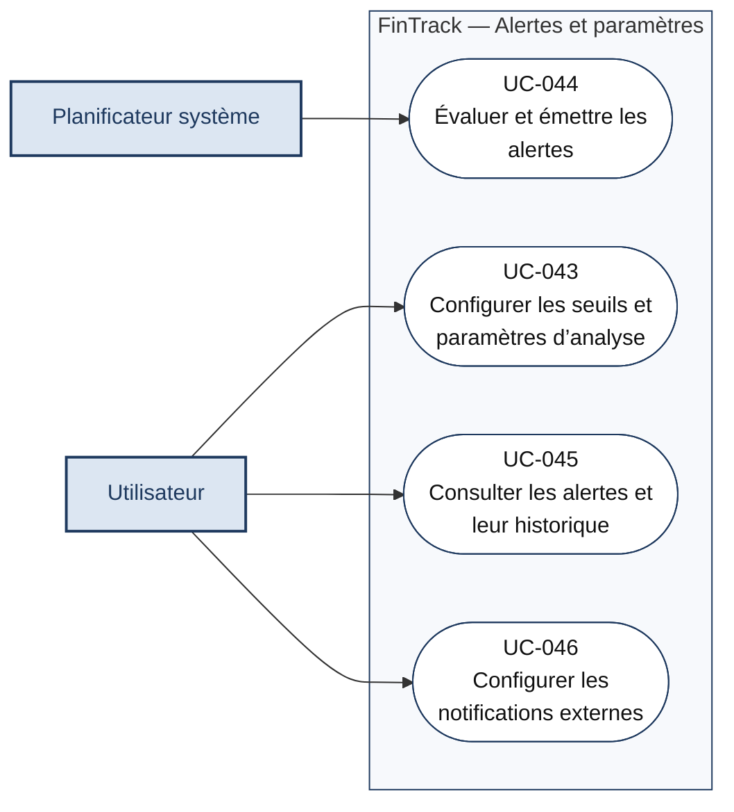

## 10. Prévisions et récurrences

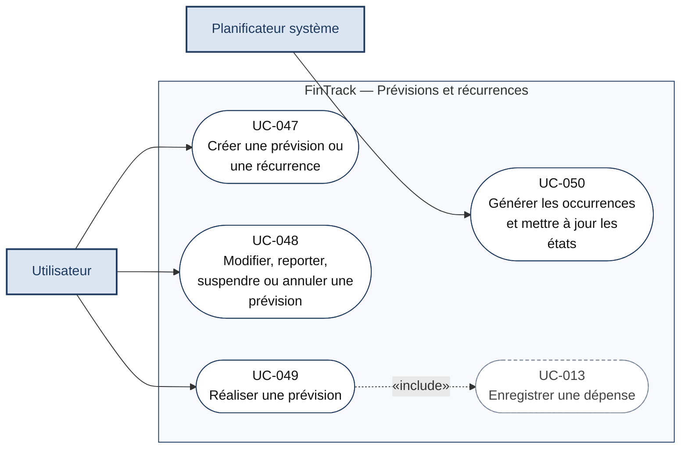

## 11. Analyses et rapports

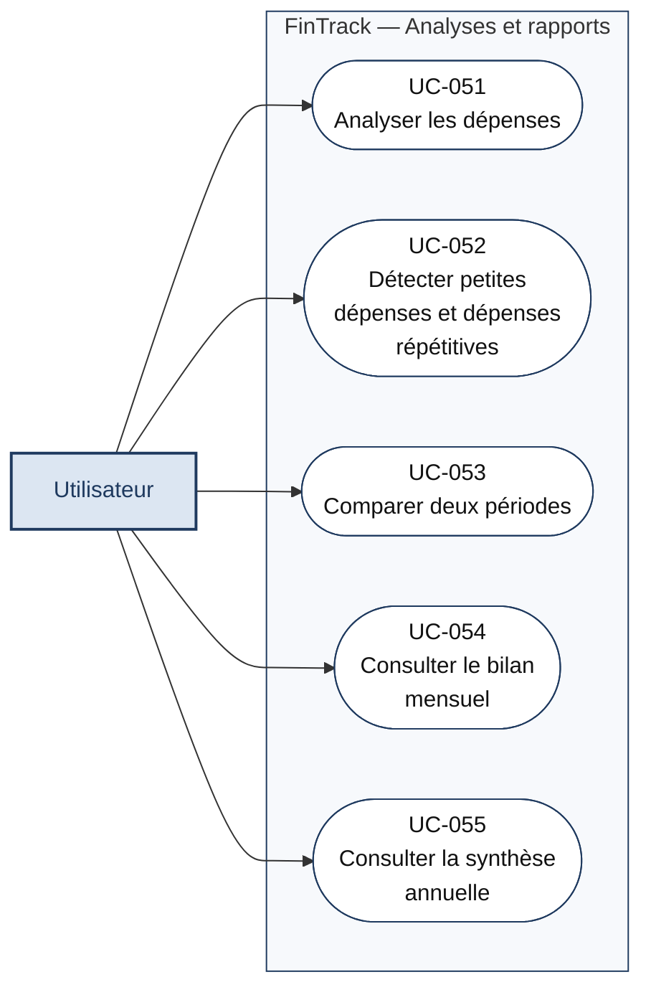

## 12. Sauvegarde, export et accès

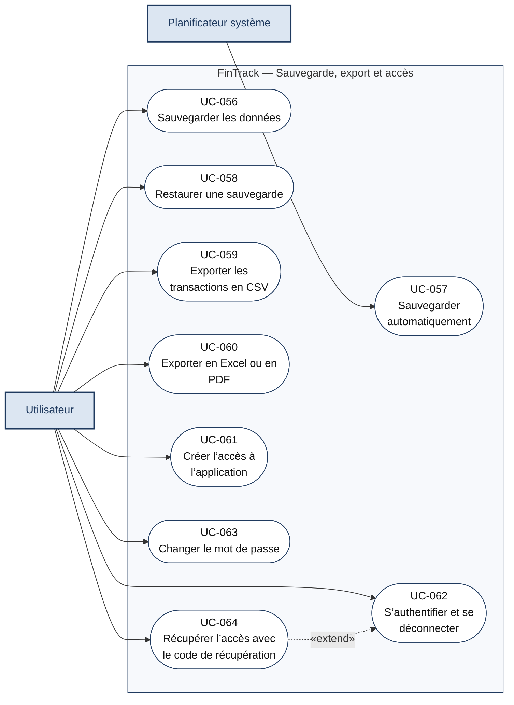

## Catalogue des cas d’utilisation

| ID | Cas d’utilisation | Module | Acteur | Lot |
|---|---|---|---|---|
| UC-001 | Créer un compte | Comptes et devises | Utilisateur | 1 |
| UC-002 | Consulter les comptes et les soldes | Comptes et devises | Utilisateur | 1 |
| UC-003 | Modifier un compte | Comptes et devises | Utilisateur | 1 |
| UC-004 | Désactiver un compte | Comptes et devises | Utilisateur | 1 |
| UC-005 | Définir la devise de référence | Comptes et devises | Utilisateur | 1 |
| UC-006 | Définir ou modifier le taux de change USD/CDF | Comptes et devises | Utilisateur | 1 |
| UC-007 | Consulter l’historique des taux | Comptes et devises | Utilisateur | 1 |
| UC-008 | Convertir un montant (inclus) | Comptes et devises | Aucun (cas inclus) | 1 |
| UC-009 | Gérer les catégories | Catégories et qualification | Utilisateur | 1 |
| UC-010 | Catégoriser une transaction (inclus) | Catégories et qualification | Aucun (cas inclus) | 1 |
| UC-011 | Qualifier une dépense | Catégories et qualification | Utilisateur | 1 |
| UC-012 | Enregistrer un revenu | Saisie des opérations | Utilisateur | 1 |
| UC-013 | Enregistrer une dépense | Saisie des opérations | Utilisateur | 1 |
| UC-014 | Contrôler les fonds et affecter les sources (inclus) | Saisie des opérations | Aucun (cas inclus) | 1 |
| UC-015 | Enregistrer un transfert | Saisie des opérations | Utilisateur | 1 |
| UC-016 | Régler une dépense en paiements partiels | Saisie des opérations | Utilisateur | 3 |
| UC-017 | Enregistrer un remboursement de dépense | Saisie des opérations | Utilisateur | 3 |
| UC-018 | Enregistrer une opération « À qualifier » | Saisie des opérations | Utilisateur | 3 |
| UC-019 | Qualifier une opération en attente | Saisie des opérations | Utilisateur | 3 |
| UC-020 | Traiter un doublon potentiel | Saisie des opérations | Utilisateur | 3 |
| UC-021 | Consulter l’historique des transactions | Historique et corrections | Utilisateur | 1 |
| UC-022 | Rechercher et filtrer les transactions | Historique et corrections | Utilisateur | 1 |
| UC-023 | Consulter l’historique des événements | Historique et corrections | Utilisateur | 1 |
| UC-024 | Modifier une transaction | Historique et corrections | Utilisateur | 1 |
| UC-025 | Annuler une transaction | Historique et corrections | Utilisateur | 1 |
| UC-026 | Réaffecter les sources de financement | Historique et corrections | Utilisateur | 1 |
| UC-027 | Historiser et recalculer les effets (inclus) | Historique et corrections | Aucun (cas inclus) | 1 |
| UC-028 | Consulter le tableau de bord | Tableau de bord | Utilisateur | 1 → 3 |
| UC-029 | Choisir la période d’analyse | Tableau de bord | Utilisateur | 1 |
| UC-030 | Désigner ou créer un compte d’épargne | Épargne | Utilisateur | 2 |
| UC-031 | Créer un objectif d’épargne | Épargne | Utilisateur | 2 |
| UC-032 | Contribuer à un objectif d’épargne | Épargne | Utilisateur | 2 |
| UC-033 | Retirer de l’épargne | Épargne | Utilisateur | 2 |
| UC-034 | Suivre l’épargne | Épargne | Utilisateur | 2 |
| UC-035 | Enregistrer une dette ou un prêt reçu | Dettes et créances | Utilisateur | 2 |
| UC-036 | Enregistrer une créance | Dettes et créances | Utilisateur | 2 |
| UC-037 | Enregistrer le remboursement d’une créance | Dettes et créances | Utilisateur | 2 |
| UC-038 | Rembourser une dette | Dettes et créances | Utilisateur | 2 |
| UC-039 | Définir un budget | Budgets | Utilisateur | 2 |
| UC-040 | Modifier un budget en cours de période | Budgets | Utilisateur | 2 |
| UC-041 | Suivre un budget | Budgets | Utilisateur | 2 |
| UC-042 | Clôturer un budget en fin de période | Budgets | Planificateur système | 2 |
| UC-043 | Configurer les seuils et paramètres d’analyse | Alertes et paramètres | Utilisateur | 2 |
| UC-044 | Évaluer et émettre les alertes | Alertes et paramètres | Planificateur système | 2 → 3 |
| UC-045 | Consulter les alertes et leur historique | Alertes et paramètres | Utilisateur | 2 |
| UC-046 | Configurer les notifications externes | Alertes et paramètres | Utilisateur | 5 |
| UC-047 | Créer une prévision ou une récurrence | Prévisions et récurrences | Utilisateur | 3 |
| UC-048 | Modifier, reporter, suspendre ou annuler une prévision | Prévisions et récurrences | Utilisateur | 3 |
| UC-049 | Réaliser une prévision | Prévisions et récurrences | Utilisateur | 3 |
| UC-050 | Générer les occurrences et mettre à jour les états | Prévisions et récurrences | Planificateur système | 3 |
| UC-051 | Analyser les dépenses | Analyses et rapports | Utilisateur | 2 |
| UC-052 | Détecter petites dépenses et dépenses répétitives | Analyses et rapports | Utilisateur | 3 |
| UC-053 | Comparer deux périodes | Analyses et rapports | Utilisateur | 3 |
| UC-054 | Consulter le bilan mensuel | Analyses et rapports | Utilisateur | 3 |
| UC-055 | Consulter la synthèse annuelle | Analyses et rapports | Utilisateur | 3 |
| UC-056 | Sauvegarder les données | Sauvegarde, export et accès | Utilisateur | 4 |
| UC-057 | Sauvegarder automatiquement | Sauvegarde, export et accès | Planificateur système | 4 |
| UC-058 | Restaurer une sauvegarde | Sauvegarde, export et accès | Utilisateur | 4 |
| UC-059 | Exporter les transactions en CSV | Sauvegarde, export et accès | Utilisateur | 4 |
| UC-060 | Exporter en Excel ou en PDF | Sauvegarde, export et accès | Utilisateur | 5 |
| UC-061 | Créer l’accès à l’application | Sauvegarde, export et accès | Utilisateur | 4 |
| UC-062 | S’authentifier et se déconnecter | Sauvegarde, export et accès | Utilisateur | 4 |
| UC-063 | Changer le mot de passe | Sauvegarde, export et accès | Utilisateur | 4 |
| UC-064 | Récupérer l’accès avec le code de récupération | Sauvegarde, export et accès | Utilisateur | 4 |
