# MCD FinTrack — code Mermaid

Version 1.0 — 18 octobre 2026. Ce fichier contient le code Mermaid (`erDiagram`) du modèle conceptuel de données, avec les attributs. Le document complet est `FinTrack_MCD_V1.0.docx`.

## Conventions

- Pattes de corbeau : `||` un exactement, `|o` zéro ou un, `}o` zéro ou plusieurs, `}|` un ou plusieurs.
- Cardinalités de Merise : voir les tables du document (section 4).
- `PK` identifiant, `FK` clé étrangère, `UK` unique.
- Les noms d’entités et d’attributs sont sans accents ; les libellés des associations sont en français.

## Vue d’ensemble (simplifiée)

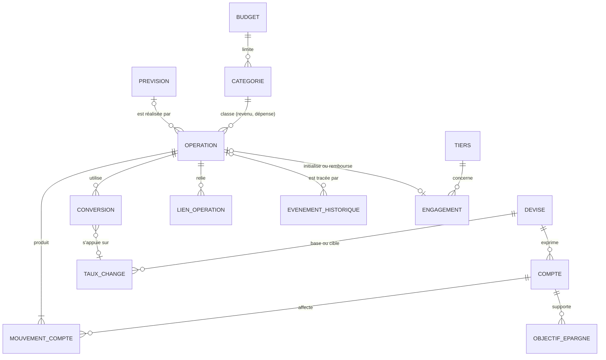

## Devises, taux de change et comptes

Le taux de change est une suite de fixations jamais modifiées. Chaque conversion réalisée garde son propre taux.

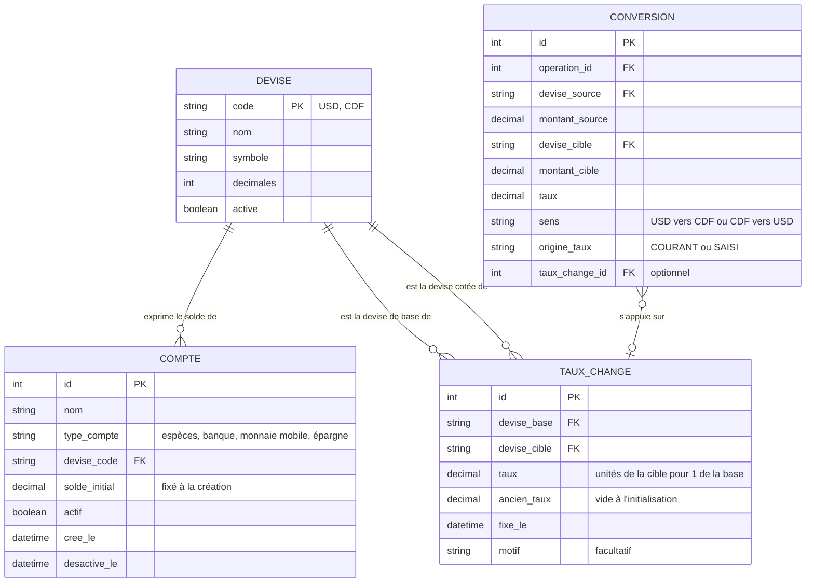

## Opérations, mouvements et spécialisations

Toute opération produit au moins un mouvement sur un compte. Le solde d’un compte se déduit du solde initial et des mouvements des opérations actives : il n’est jamais saisi. Les types d’opération (revenu, dépense, transfert, remboursement) sont des spécialisations de l’opération.

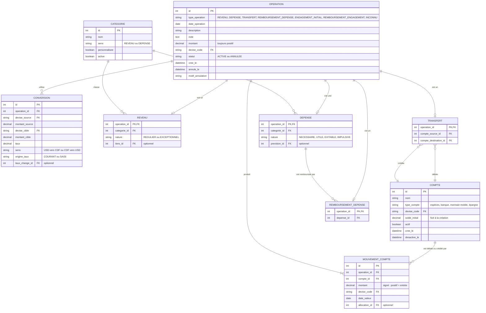

## Paiements et sources de financement

Une dépense est réglée par un ou plusieurs paiements ; chaque paiement est financé par une ou plusieurs allocations puisées dans des sources. Une même source peut financer plusieurs dépenses.

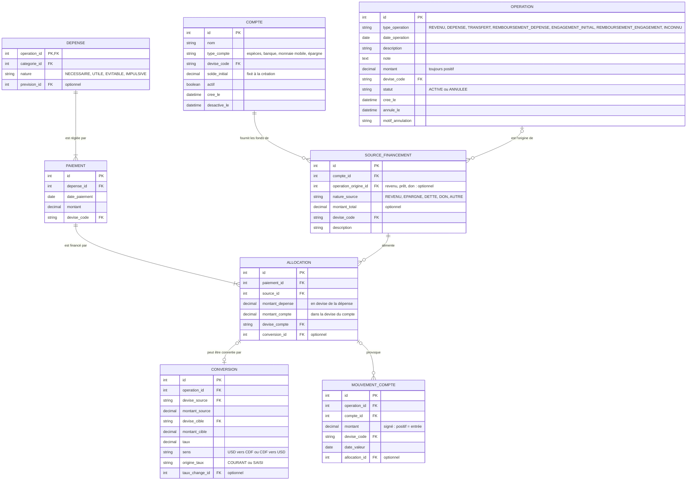

## Liens entre opérations, doublons et « À qualifier »

Les liens de causalité (doublon de, excédent de, correction de) sont conservés dans une table unique. Une opération « À qualifier » est une opération de type INCONNU : elle a ses mouvements donc modifie le solde, mais n’a aucune spécialisation, donc n’entre ni dans les revenus ni dans les dépenses.

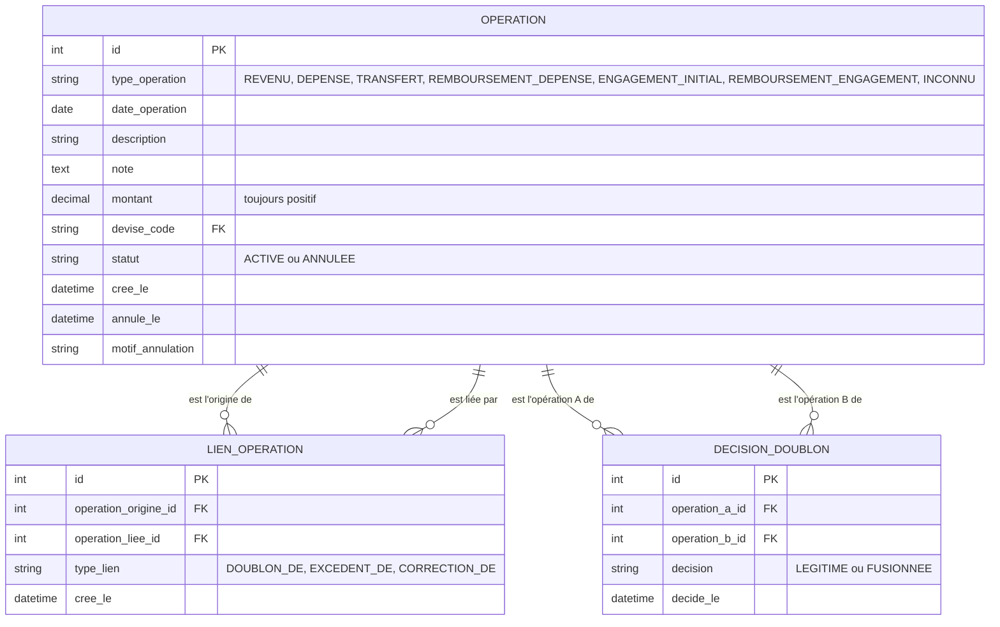

## Épargne

L’épargne est un compte réel : une contribution est un transfert vers ce compte, rattaché à un objectif.

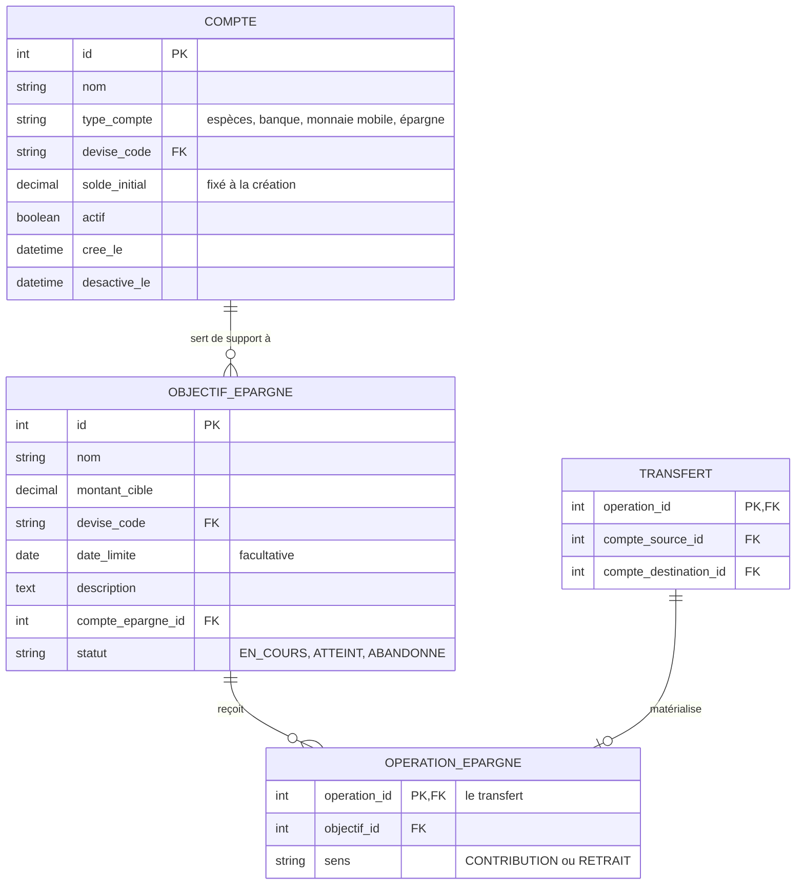

## Dettes et créances

Le restant d’une dette ou d’une créance se déduit des remboursements actifs ; il n’est pas stocké.

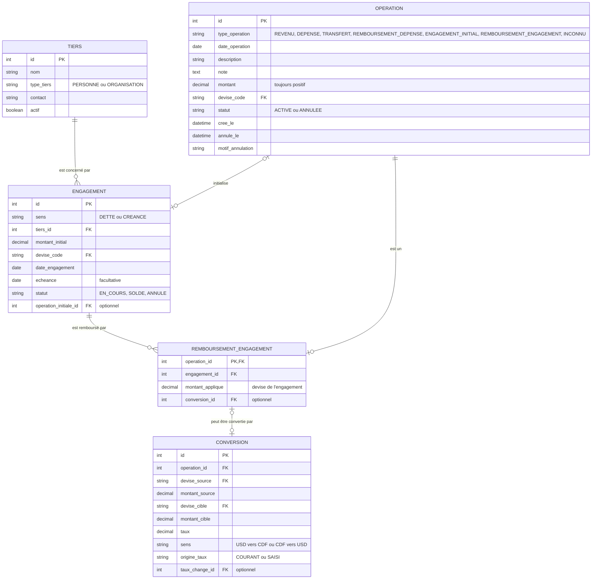

## Budgets et alertes

Un budget garde toutes ses versions et leurs périodes d’application.

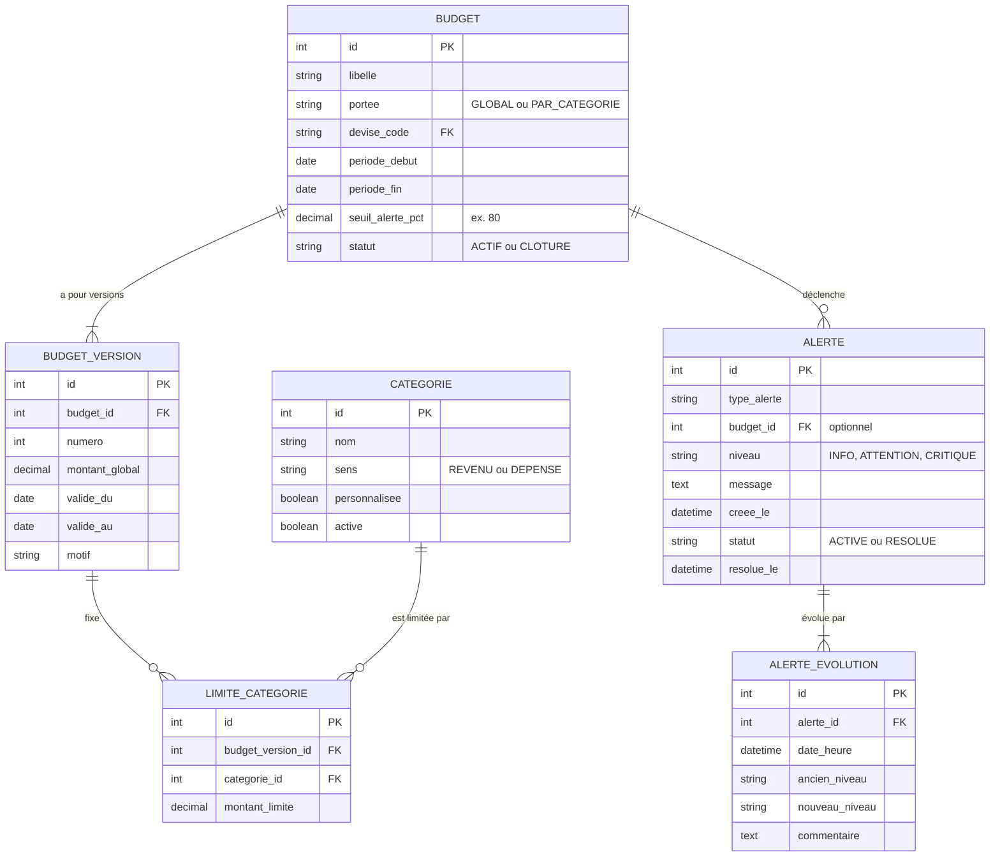

## Prévisions et récurrences

Une prévision ne produit aucun mouvement : seule la dépense réelle qui la réalise modifie les soldes.

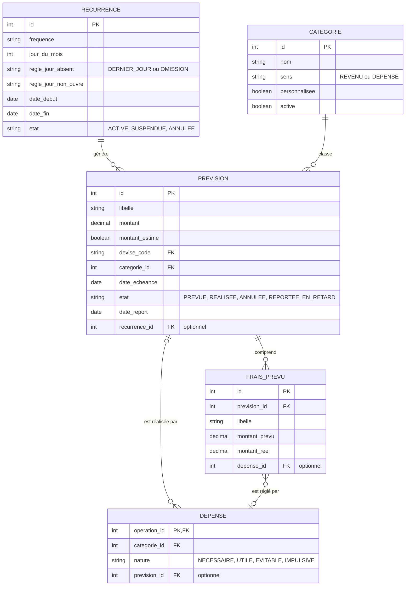

## Historique, refus et sauvegardes

Le journal d’historique et les refus sont écrits seulement : jamais modifiés ni supprimés.

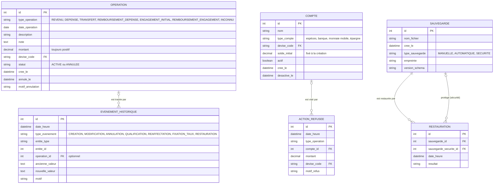

## Accès et paramètres

Application locale à un seul utilisateur : aucune entité financière n’est rattachée à un propriétaire.

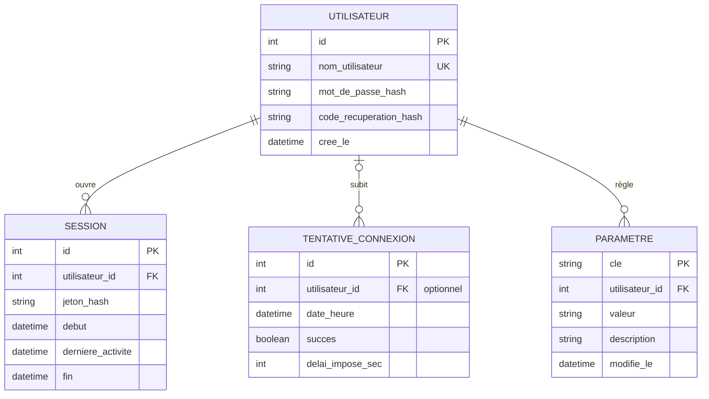
